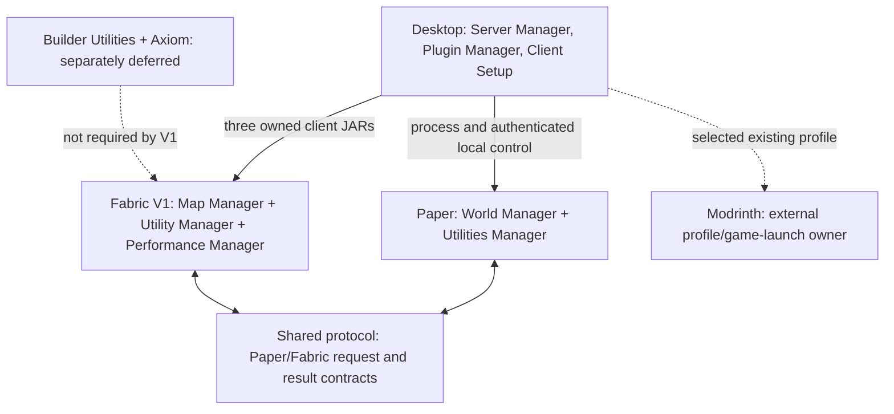
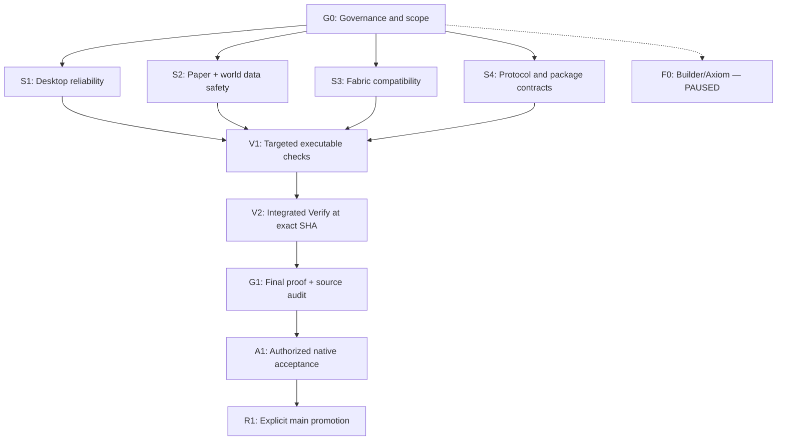

# LazyBuilder Project Map

> **Panduan utama:** What is LazyBuilder, what are we improving, where are we in the proof/release process, and what depends on what?
>
> This is a **derived navigation map**: Work Breakdown Structure (WBS) + dependency graph + proof guide. It is NOT a second roadmap database, per-feature status tracker, new agent rule, or evidence of test success.

## How to read the current project state

- **Product and owners:** [Product](../01-product/README.md) and [Module Boundaries](../04-system/module-boundaries.md).
- **Current phase, blockers, required next gate:** [Current Verification Authority](current-verification.md), with [reproduced remediation findings](local-pc-remediation-2026-09-15.md) when material.
- **Actual work and proof:** current `Local` source, relevant commits with `Work / State / Proof / Unresolved / Next`, and evidence for the **same SHA** under [Development Operations](../04-system/development-operations.md).
- **Branch boundary:** `Local` is active development; `main` is stable. A workstream labeled DONE in a commit is not equivalent to release acceptance.

No mutable backlog, percentages, per-lane PASS/FAIL cells or pinned current commit SHA are maintained in this file. Check the owners above for live truth.

## 1. Product topology

This graph is a **product integration topology**, not proof that the components have been executed together. Desktop does not own Paper world business logic; Modrinth is not replaced by LazyBuilder. Builder Utilities/Axiom are **PAUSED** by product decision.

## 2. Work breakdown structure (WBS)

| ID | Workstream | What must be correct? | Canonical owner |
| --- | --- | --- | --- |
| G0 | Repository governance | One branching/rules/skills/ownership model and consistent documentation | [GitHub Rules](../../GITHUB_RULES.md), [Module Boundaries](../04-system/module-boundaries.md) |
| S1 | Desktop / multi-server | Workspace/provisioning, three-server lifecycle, plugin/client setup, process ownership and recovery | [Launcher](../../apps/launcher/README.md) |
| S2 | Paper / World Manager | World lifecycle, import/export, conversion, snapshots, backup/rollback and data safety | [World Management](../02-world-management/README.md) |
| S3 | Fabric / client suite | Map, Utility and Performance Managers integrate without conflicting ownership or breaking gameplay | [Client UI](../03-client-ui/README.md), [Module Boundaries](../04-system/module-boundaries.md) |
| S4 | Cross-boundary consistency | Shared protocols, desktop control, source-version matching, resources and packaging agree | [Networking](../04-system/networking.md), [Development Operations](../04-system/development-operations.md) |
| V1 | Targeted executable verification | Relevant Maven/Gradle/Rust/frontend tests and guards **actually run** for the changed source | [Development Operations](../04-system/development-operations.md) |
| V2 | Integrated exact-SHA Verify | One candidate passes repository, Paper, Fabric, Launcher, Paper runtime smoke, NSIS and installer smoke checks | [Current Verification](current-verification.md) |
| G1 | Final proof/source audit | Reconcile unresolved P0/P1, artifact provenance and proof ceiling for the exact candidate | [Current Verification](current-verification.md) |
| A1 | Native product acceptance | Exact approved candidate tested in the real required Windows/Minecraft environment | [Local PC Validation Plan](local-pc-validation-plan.md) |
| R1 | Stable promotion | Explicit maintainer decision to promote verified `Local` to `main` | [GitHub Rules](../../GITHUB_RULES.md) |
| F0 | Builder Utilities / Axiom | Independent extension work: **deferred**, not a hidden V1 prerequisite | [Product / Builder Extension](../01-product/README.md) |

The IDs are **navigation labels** only—not persisted issue identifiers, stored completion flags or a replacement for product/source authority.

## 3. Dependency graph: from development to release

S1–S4 can receive bounded source fixes independently. V1/V2 must establish proof for the **same combined candidate**, not reuse an old green workflow. V2 already covers disposable Paper runtime and installer smoke; do not invent another parallel repository-readiness workflow.

Manual GitHub Actions dispatch depends on registration on the default branch. A missing dispatcher is a **verification prerequisite**, never authority to change `main`, default branch, or release policy. Exact-hardware/multi-server user acceptance remains distinct from source checks.

## 4. What does "done" mean?

| Evidence label | What was established | Not established |
| --- | --- | --- |
| `SOURCE_IMPLEMENTED` | Code is committed | It built or passed a test |
| `STATIC_SOURCE` | Source/contract checks were performed | Maven, Gradle, Rust, Paper or Fabric executed |
| `EXECUTED_SOURCE` | Executable test/build ran and result was recorded | In-game behavior or native acceptance |
| `INTEGRATION_FIXTURE` | Relevant cooperating services/filesystem fixture ran | Real Paper/Fabric or installed Windows app |
| `LIVE_RUNTIME` | Specific path exercised in a matching live runtime | Whole product release readiness |
| `NATIVE_ACCEPTANCE` | Specified installed-host candidate was exercised | Automatic authorization to promote |
| `UNKNOWN / NOT EXECUTED` | Matching evidence is unavailable | PASS or FAIL |
| `PAUSED` | Explicitly out of current development scope | A defect or release blocker by itself |

The formal proof and failure vocabulary is owned by [Development Discipline](../04-system/development-discipline.md) and [Current Verification](current-verification.md), not by this navigation summary.

## 5. Standard progress answer

For "LazyBuilder sekarang sampai mana?", answer in this order:

1. **Current phase:** read [Current Verification](current-verification.md).
2. **Workstream:** select exactly one G0/S1/S2/S3/S4 owner and its affected files.
3. **Implemented:** cite the relevant current `Local` commits/source. Do not equate past `State: DONE` with entire project DONE.
4. **Verified:** cite a matching exact-SHA run and its scope; otherwise say `UNKNOWN / NOT EXECUTED`.
5. **Blocked and next:** name one prerequisite and one next verifiable gate. Source work on GitHub does not require handing code/testing to the user's PC.
6. **Deferred:** keep F0 outside V1/V2 unless the user explicitly resumes it.

**Maintenance rule:** Update this map only when product topology, WBS owners or dependency edges actually change. Update current phase, evidence and release decisions at the existing authorities. Do not create `TASKS.md`, `STATUS.md`, a second roadmap, a second graph engine or a separate completion database.
